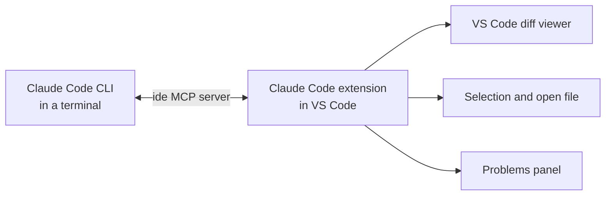

You can run Claude Code in a terminal, inside your IDE, and in the Code tab of Claude Desktop. Every interface runs Claude Code, so each one reads the same CLAUDE.md files and settings. The difference is how you review and steer the work.

This page covers VS Code, the JetBrains IDEs, and Visual Studio, because these are the IDEs that most Java and C# developers use. It explains when to use each interface and how to connect the Claude Code CLI to each IDE. To install the CLI and sign in, see [Install and configure the CLI](/docs/cli/install-and-configure). For everyday commands, see [Common task reference](/docs/cli/common-tasks).

## Choose an interface

Pick the interface that matches the task, not a single interface for all work. You can use more than one on the same project at the same time.

| Interface | Best for | Why |
| --- | --- | --- |
| Claude Code CLI | Scripted or automated work, long agentic tasks, and every built-in command | The CLI has all commands and flags, including non-interactive mode (`claude -p`). It runs in any terminal, including the terminal of each IDE on this page. |
| VS Code extension | Regular edits in code that you have open in VS Code | Claude sees your selection and open file. You review each change in the VS Code diff viewer, next to the code. |
| JetBrains plugin with the CLI | Java work in IntelliJ IDEA and C# work in Rider | The plugin connects the CLI to the IDE. Claude sees your selection, opens changes in the IDE diff viewer, and can read the IDE inspections. |
| CLI in the Visual Studio terminal | C# work in Visual Studio | Claude Code has no Visual Studio integration. The CLI runs in the Visual Studio terminal, and you review changes with Git. |
| Claude Desktop, Code tab | Parallel sessions, visual review of a whole change, and previews of a running app | Desktop manages many sessions in one window and shows panes for the diff, a terminal, and a browser side by side. |

The extension supports a subset of the CLI commands. Type `/` in the extension prompt box to see the commands that it supports. If you need a command that the extension does not have, run the CLI in the VS Code integrated terminal. See [VS Code extension vs. Claude Code CLI](https://code.claude.com/docs/en/vs-code#vs-code-extension-vs-claude-code-cli).

### What the interfaces share

Because every interface runs Claude Code, a project that is configured for one is configured for all. They share:

- CLAUDE.md files and `.claude/rules/`. See [Guideline files](/docs/general-tips/guideline-files).
- Settings in `~/.claude/settings.json`, `.claude/settings.json`, and `.claude/settings.local.json`, including permission rules and hooks.
- MCP servers in `~/.claude.json` and `.mcp.json`.
- Skills and plugins. A plugin that you install at user scope in the extension is also available in the CLI, and the reverse. See [Plugins](/docs/cli/plugins).

Session history is shared differently:

- The VS Code extension and the CLI share the same conversation history. Run `claude --resume` in a terminal to continue a conversation that you started in the extension.
- The JetBrains plugin runs the CLI in the IDE terminal, so its sessions are CLI sessions. The same is true for the CLI in the Visual Studio terminal.
- Claude Desktop keeps its own session list. You can move a CLI session into Desktop, and continue it there. See [Common task reference](/docs/cli/common-tasks).

Sources: [Switch between extension and CLI](https://code.claude.com/docs/en/vs-code#switch-between-extension-and-cli) and [Desktop: Coming from the CLI](https://code.claude.com/docs/en/desktop#coming-from-the-cli).

## Install the VS Code extension

The extension is named **Claude Code**, and Anthropic publishes it. It requires a recent version of VS Code. See the [prerequisites](https://code.claude.com/docs/en/vs-code#prerequisites).

{}

### Open the Extensions view

In VS Code, press `Ctrl+Shift+X` on Windows or `Cmd+Shift+X` on macOS.

### Install the extension

Search for **Claude Code**, and then select **Install** on the extension from Anthropic.

In Cursor, use the same steps in the Cursor Extensions view. In other VS Code forks, such as Devin Desktop or Kiro, search the Extensions view of the editor, or install the extension from the [Open VSX registry](https://open-vsx.org/extension/Anthropic/claude-code).

### Trust the workspace

Open your repository folder, and trust the workspace when VS Code asks. The extension does not work in Restricted Mode.

### Sign in

Select the Spark icon in the editor toolbar to open the Claude Code panel. Select **Sign in**, and complete the Claude Enterprise sign-in in your browser.

The panel shows the prompt box. If the icon does not appear, open a file, or select **Claude Code** in the status bar.

{}

The extension contains its own copy of Claude Code for the panel. It does not add the `claude` command to your PATH. To run `claude` in a terminal, install the CLI as well. See [Install and configure the CLI](/docs/cli/install-and-configure).


If you run `claude` in a VS Code integrated terminal, Claude Code installs the extension automatically. To disable the automatic install, see [Configure the integration](#configure-the-integration).


<!-- SCREENSHOT: VS Code with the Claude Code panel open in the secondary sidebar, a file open in the editor, and the permission mode indicator visible at the bottom of the prompt box. Use a sample project with no internal names. -->

## Work in the extension

### Open the panel

Use one of these methods to open Claude Code in VS Code:

- Select the Spark icon in the editor toolbar. The icon appears only when a file is open.
- Select the Spark icon in the Activity Bar to open the sessions list.
- Select **Claude Code** in the status bar. This works when no file is open.
- Open the Command Palette, type `Claude Code`, and select a command such as **Open in New Tab**.

You can drag the panel to the secondary sidebar, the primary sidebar, or the editor area. Keep your main session in the sidebar, and open more conversations in tabs for separate, smaller tasks. Each conversation has its own context window.

### Give Claude context

The extension sends context from the editor with your prompt:

- **Selection.** Claude sees the text that you select in the editor. The prompt box footer shows the number of selected lines.
- **Open file.** Claude sees the name of the file that is open in the editor, even when nothing is selected.
- **@-mentions.** Type `@` and a file or folder name to add it to the prompt. Partial names match. Add a trailing slash for a folder, for example `@src/components/`.
- **Selection as a reference.** With the editor focused, press `Alt+K` on Windows or `Option+K` on macOS. The extension inserts a reference with the file path and line numbers, for example `@app.ts#5-10`.
- **Terminal output.** Type `@terminal:<NAME>` to give Claude the output of a VS Code terminal, where `<NAME>` is the title of the terminal.
- **Images and files.** Paste an image into the prompt box. Hold `Shift` and drag a file into the prompt box to attach it.

An @-mention is better than a paste. The reference keeps the file path, so Claude can read the current version later. For one part of a large file, select the lines or ask Claude to find that part. See [How content enters the context window](/docs/general-tips/context#how-content-enters-the-context-window).

Before you change code that you do not know well, select it and ask Claude to review it first. See [Review the selected code before you change it](/docs/prompts/review#review-the-selected-code-before-you-change-it).

### Review changes

The permission mode controls when Claude asks before it edits a file. In **Manual** mode, Claude shows each proposed edit in the VS Code diff viewer and asks for permission. You can accept the edit, reject it, or tell Claude what to do instead.

To review a large edit one change at a time, use **Accept this change** and **Reject this change** under each change in the diff. If you edit the proposed content in the diff before you accept it, Claude is told that you changed it.

To undo work, hover over a message and select the rewind button. You can rewind the code, fork the conversation, or both. See [Checkpointing](https://code.claude.com/docs/en/checkpointing).

### Choose a permission mode

Select the mode indicator at the bottom of the prompt box to change the mode. The extension offers these modes:

| Mode | What Claude does | Use it when |
| --- | --- | --- |
| **Manual** | Asks before file edits and most shell commands | You want to review every change, for example in unfamiliar code |
| **Plan** | Describes a plan and waits for your approval before it makes changes | The task touches many files, or you want to agree on the approach first |
| **Edit automatically** | Makes file edits without asking | You trust the scope of the task and review the result with Git afterwards |
| **Auto** | A classifier reviews most actions instead of asking you | You want fewer prompts and accept the classifier as a safety check |

In **Plan** mode, VS Code opens the plan as a Markdown document. Add comments to the plan before Claude starts. A short review of the plan costs less than a review of the wrong change.

A Claude Enterprise administrator can disable some modes, such as **Auto**, through managed settings. If a mode is missing from the indicator, ask your administrator. See [Choose a permission mode](https://code.claude.com/docs/en/permission-modes).

### Keyboard shortcuts

| Action | Windows | macOS |
| --- | --- | --- |
| Move focus between the editor and the prompt box | `Ctrl+Esc` | `Cmd+Esc` |
| Open a new conversation in an editor tab | `Ctrl+Shift+Esc` | `Cmd+Shift+Esc` |
| Insert an @-mention for the current file and selection (editor focused) | `Alt+K` | `Option+K` |
| Add a new line without sending the prompt | `Shift+Enter` | `Shift+Enter` |
| Expand or collapse all thinking blocks | `Ctrl+O` | `Ctrl+O` |
| Hide or show tool activity (Focus view) | `Ctrl+Alt+F` | `Ctrl+Option+F` |
| Reopen the last closed Claude session tab | `Ctrl+Shift+T` | `Cmd+Shift+T` |
| Open the Command Palette | `Ctrl+Shift+P` | `Cmd+Shift+P` |

On recent macOS versions, the system Game Overlay shortcut uses `Cmd+Esc`. If the shortcut does nothing, clear **Game Overlay** in **System Settings** > **Keyboard** > **Keyboard Shortcuts** > **Game Controllers**, or assign a different key to **Claude Code: Focus input** in VS Code.

For the complete list, see [VS Code commands and shortcuts](https://code.claude.com/docs/en/vs-code#vs-code-commands-and-shortcuts).

## Use the CLI in the VS Code terminal

Run the CLI in the VS Code integrated terminal when you need a command or flag that the extension does not have. The CLI connects to VS Code through a local MCP server that the extension runs. This server is named `ide`.



When the CLI is connected, you get:

- **Diff viewing.** Claude opens proposed changes in the VS Code diff viewer, not in the terminal.
- **Selection context.** The CLI sends your editor selection and the path of the active file with each prompt. The transcript shows a line such as `⧉ Selected 12 lines from <FILE>`.
- **Diagnostics.** Claude can read the errors and warnings in the VS Code **Problems** panel through the `getDiagnostics` tool. Claude calls this tool when it needs it, so ask for it explicitly when it matters.

The extension panel can also read the **Problems** panel, through a separate built-in server named `claude-vscode`. Permission rules and hooks see the two tools as `mcp__ide__getDiagnostics` and `mcp__claude-vscode__getDiagnostics`. A rule or hook that must cover diagnostics in both the CLI and the panel names both tools. See [The built-in IDE MCP server](https://code.claude.com/docs/en/vs-code#the-built-in-ide-mcp-server).

Ask Claude to fix the problems that VS Code reports. See [Fix the problems that the IDE reports](/docs/prompts/maintenance#fix-the-problems-that-the-ide-reports).

{}

### Open the integrated terminal

In VS Code, select **View** > **Terminal**, or press `` Ctrl+` `` on Windows or macOS. See [VS Code default keyboard shortcuts](https://code.visualstudio.com/docs/reference/default-keybindings).

### Start the CLI

Run the following command in the repository root:

```shell
claude
```

The CLI connects to VS Code automatically when it starts in the integrated terminal.

### Check the connection

Run the `/ide` command in the CLI. It shows the status of the IDE integration and lets you select an IDE if more than one is running.

### Enable multiline input

If `Shift+Enter` does not add a new line in the VS Code terminal, configure it one time. See [Enable multiline input](/docs/cli/install-and-configure#enable-multiline-input).

{}

If you start the CLI in an external terminal, run `/ide` to connect it to a running VS Code window. To connect at startup, run the following command:

```shell
claude --ide
```

The `--ide` flag connects when exactly one IDE is available. See [CLI reference](https://code.claude.com/docs/en/cli-reference).

### Notes for Windows

- **Terminal profile.** Start `claude` from a PowerShell or Command Prompt terminal profile. These are the shells that the native Windows installer supports.
- **Shell for Claude.** The shells that Claude uses for commands depend on Git for Windows. Without Git for Windows, Claude has only the PowerShell tool. With Git for Windows, Claude has both tools: PowerShell is the primary shell, and Bash runs POSIX scripts. Install Git for Windows so that Claude can run the Bash scripts in your repository and the tools that need Git Bash. See [Install and configure the CLI](/docs/cli/install-and-configure) and [PowerShell tool](https://code.claude.com/docs/en/tools-reference#powershell-tool).
- **PATH after install.** A VS Code terminal takes its PATH from VS Code. If `claude` is not found after you install the CLI, close all VS Code windows and start VS Code again.
- **WSL.** If you work in WSL, install the CLI inside WSL, and open the folder in a VS Code window that is connected to WSL. In that window, the Claude Code settings files are on the WSL side, so edit `~/.claude/settings.json` there. See [Use WSL 2 instead](/docs/cli/install-and-configure#use-wsl-2-instead).

## Configure the integration

Two different files hold the configuration:

- **VS Code settings** control how the extension behaves in VS Code. Open them with `Ctrl+,` on Windows or `Cmd+,` on macOS, and open **Extensions** > **Claude Code**.
- **Claude Code settings** in `~/.claude/settings.json` and `.claude/settings.json` apply to the extension, the CLI, and Claude Desktop. Put permission rules, hooks, and environment variables for your team here, not in VS Code settings. See [Settings files](/docs/general-tips/settings-file).

### Choose where diffs open

The `diffTool` setting controls where the CLI shows a proposed change when an IDE is connected. The value `auto` opens the change in the IDE diff viewer, and is the default. The value `terminal` keeps the change in the terminal.

To change it, run `/config` in the CLI while it is connected to VS Code, and change **Diff tool**. Claude Code saves this setting in `~/.claude.json`. Change it only through `/config`, not by editing the file. Claude Code ignores `diffTool` in `settings.json`.

Two related options in `/config` control the connection. Change them in `/config` in the same way:

| Option in `/config` | Default | Effect | Where it appears |
| --- | --- | --- | --- |
| **Auto-connect to IDE (external terminal)** | Off | Connects to a running IDE when you start the CLI in an external terminal | When the CLI runs outside a VS Code terminal |
| **Auto-install IDE extension** | On | Installs the extension when you run the CLI in a VS Code terminal | When the CLI runs inside a VS Code terminal |

See [diffTool](https://code.claude.com/docs/en/settings-reference#difftool), [autoConnectIde](https://code.claude.com/docs/en/settings-reference#autoconnectide), and [autoInstallIdeExtension](https://code.claude.com/docs/en/settings-reference#autoinstallideextension).

### Extension settings that matter for teams

These VS Code settings affect what Claude sees and how much it can do. Agree on them as a team, and record the agreement in your onboarding notes.

| Setting | Default | Why it matters |
| --- | --- | --- |
| `claudeCode.initialPermissionMode` | Not set | Sets the permission mode for new conversations. VS Code reads it from user settings only and ignores workspace settings. |
| `claudeCode.attachSelection` | `true` | Sends the text that you select to Claude. Also applies to the CLI in the integrated terminal. |
| `claudeCode.attachOpenFile` | `true` | Sends the name of the open file to Claude. Also applies to the CLI in the integrated terminal. |
| `claudeCode.respectGitIgnore` | `true` | Excludes Git-ignored files from file searches and from selection context in the panel |
| `claudeCode.autosave` | `true` | Saves files before Claude reads or writes them, so that Claude does not work on an old version |
| `claudeCode.allowDangerouslySkipPermissions` | `false` | Adds **Bypass permissions** to the mode indicator. Leave it disabled unless VS Code runs inside an isolated environment, for example a Docker sandbox that you connect to with Remote - SSH. See [Sandboxes](/docs/general-tips/sandboxes). |

The extension also ignores `permissions.defaultMode` in `.claude/settings.json` and `.claude/settings.local.json`. To select the starting mode of a new conversation, it checks `initialPermissionMode` first. Next, it uses the mode that you selected last, if that mode was **Manual**, **Edit automatically**, or **Auto**. After those, it reads `permissions.defaultMode` from `~/.claude/settings.json`, from managed settings, or from a `--settings` value. A project default in `.claude/settings.json` applies to the CLI, including the CLI in the VS Code terminal, and to Claude Desktop. To start each extension conversation in **Manual** mode, set `claudeCode.initialPermissionMode` to `default` in your VS Code user settings. See [Switch permission modes](https://code.claude.com/docs/en/permission-modes#switch-permission-modes) and the full [extension settings](https://code.claude.com/docs/en/vs-code#extension-settings).

### Keep sensitive files out of the context

The selection filter for ignored files applies only to the extension panel. When the CLI runs in the integrated terminal, Claude can receive text that you select in a Git-ignored file. To block a file in every interface, add a `Read` deny rule to the project settings:

```json {filename=".claude/settings.json"}
{
  "$schema": "https://json.schemastore.org/claude-code-settings.json",
  "permissions": {
    "deny": [
      "Read(./.env)",
      "Read(./secrets/**)"
    ]
  }
}
```

A matching `Read` deny rule stops both the selected text and the open-file notice for that file. The `$schema` line gives you completion and validation for the settings file in VS Code. See [Permissions](https://code.claude.com/docs/en/permissions).

## Use the CLI with JetBrains IDEs

The Claude Code plugin for JetBrains IDEs connects the CLI to the IDE. Unlike the VS Code extension, the plugin has no chat panel and no copy of Claude Code. It runs the `claude` command in the IDE terminal and gives the CLI access to the IDE.

The plugin works with most JetBrains IDEs. The JetBrains Marketplace lists both IntelliJ IDEA and Rider as compatible products. See [JetBrains IDEs](https://code.claude.com/docs/en/jetbrains) and the [plugin page](https://plugins.jetbrains.com/plugin/27310-claude-code-beta-).

When the CLI is connected to a JetBrains IDE, you get:

- **Diff viewing.** Claude opens proposed changes in the IDE diff viewer.
- **Selection context.** The CLI sends your selection or the open tab with each prompt.
- **Diagnostics.** Claude can read the inspection results of the IDE, such as compiler and lint errors, through the `getDiagnostics` tool. Each call covers one file. Claude calls the tool only when it needs it, so ask for it explicitly.

Ask Claude to fix the problems that the IDE reports. See [Fix the problems that the IDE reports](/docs/prompts/maintenance#fix-the-problems-that-the-ide-reports).

To install the plugin and start the CLI, do these steps:

{}

### Install the CLI on your PATH

The plugin needs the CLI on your PATH. See [Install and configure the CLI](/docs/cli/install-and-configure).

### Install the plugin

In the IDE, open **Settings** > **Plugins** > **Marketplace**. Search for **Claude Code [Beta]**, the plugin from Anthropic, and select **Install**.

### Restart the IDE

Close and start the IDE again. The plugin is not active until the IDE restarts.

### Start the CLI in the IDE

Open your project, and open the IDE terminal. Run the following command in the project root:

```shell
claude
```

The CLI connects to the IDE automatically. The first time, the CLI asks you to sign in with your Claude Enterprise account.

{}

If you start the CLI in an external terminal, run the `/ide` command to connect it. When the connection works, the CLI shows a message such as `Connected to IntelliJ IDEA.` Start the CLI in the project root of the IDE, so that Claude works with the same files as the IDE.


In a JetBrains IDE, a mode that approves edits without asking can let Claude change IDE configuration files that the IDE runs automatically. This can bypass the permission prompts for shell commands. Prefer **Manual** mode in JetBrains IDEs. See [Security considerations](https://code.claude.com/docs/en/jetbrains#security-considerations).


### JetBrains keyboard shortcuts

| Action | Windows | macOS |
| --- | --- | --- |
| Open Claude Code from the editor | `Ctrl+Esc` | `Cmd+Esc` |
| Insert a file reference, such as `@src/Main.java#L1-99` | `Alt+Ctrl+K` | `Cmd+Option+K` |
| Interrupt Claude in the IDE terminal | `Esc` | `Esc` |

If `Esc` does not interrupt Claude, the IDE terminal uses the key to move focus to the editor. Open **Settings** > **Tools** > **Terminal**, and clear **Move focus to the editor with Escape**.

### Configure the JetBrains plugin

The plugin settings are in **Settings** > **Tools** > **Claude Code [Beta]**. The most important setting is **Claude command**. Set it to the full path of `claude` if the plugin reports that it cannot start Claude Code.

The **Diff tool** option in `/config` also applies to JetBrains IDEs. It appears only while the CLI is connected to the IDE. See [Choose where diffs open](#choose-where-diffs-open).

### Platform notes for JetBrains IDEs



- **PATH after install.** If the plugin cannot find `claude` after you install the CLI, restart the IDE. If the problem continues, set **Claude command** to the full path of `claude.exe`.
- **WSL.** If the CLI is installed in WSL, set **Claude command** to the following command, where `<DISTRIBUTION>` is the name of your WSL distribution, for example `Ubuntu`:

  ```shell
  wsl -d <DISTRIBUTION> -- bash -lic "claude"
  ```

- **IDE not detected from WSL.** If `/ide` reports that no IDE is available, the WSL 2 network or Windows Firewall blocks the connection. Add a firewall rule for the WSL 2 subnet, or enable mirrored networking for WSL 2. See [WSL configuration](https://code.claude.com/docs/en/jetbrains#wsl-configuration).
- Do not enable **Accept connections from all network interfaces** in the plugin settings unless no other fix works. It makes the IDE connection reachable from your local network without encryption.


- **Multiline input.** To add a new line with `Option+Enter`, enable **Enable using Option+Enter for multi-line prompts** in the plugin settings. Restart the IDE terminal afterwards.
- **PATH after install.** If the plugin cannot find `claude` after you install the CLI, restart the IDE. If the problem continues, set **Claude command** to the full path of `claude`.



For remote development, install the plugin on the remote host, not on your local computer. See [Remote development](https://code.claude.com/docs/en/jetbrains#remote-development).

## Use the CLI with Visual Studio

Claude Code has no official integration for Visual Studio. There is no extension, and the `/ide` command cannot connect to Visual Studio. Run the CLI in the Visual Studio terminal instead. Do not install unofficial extensions that claim to connect Claude Code to Visual Studio.

To run the CLI in the Visual Studio terminal, do these steps:

{}

### Install the CLI and restart Visual Studio

Install the CLI for Windows. See [Install and configure the CLI](/docs/cli/install-and-configure). If Visual Studio is open, restart it, so that its terminal gets the new PATH.

### Open the terminal

Open your solution, and select **View** > **Terminal**. The terminal opens a Developer PowerShell in the directory of the solution. See [Command-line shells in Visual Studio](https://learn.microsoft.com/en-us/visualstudio/ide/reference/command-prompt-powershell).

### Change to the repository root

If the solution file is not in the repository root, run the following command:

```shell
cd <REPOSITORY_ROOT>
```

Replace `<REPOSITORY_ROOT>` with the path of the repository root. Claude Code works in the directory where you start it, so start it where your CLAUDE.md file and `.claude/` directory are.

### Start the CLI in Visual Studio

Run the following command:

```shell
claude
```

{}

### What is missing without an IDE connection

| Feature | With an IDE connection | In the Visual Studio terminal |
| --- | --- | --- |
| Diff viewing | Changes open in the IDE diff viewer | Changes show in the terminal. Review them in the **Git Changes** window. |
| Selection context | Claude sees your selection and open file | Claude does not see the editor. Name the file and the lines in your prompt. |
| Diagnostics | Claude can read the errors that the IDE shows | Claude cannot read the **Error List**. Ask Claude to build the solution and read the compiler output. |

### Work without an IDE connection

- **Give context with @-mentions.** Type `@` and part of a file path. The CLI suggests matching files. Add the method name or the line numbers to the prompt, because Claude cannot see your selection.
- **Review each edit.** Use **Manual** mode, so that Claude shows each change and asks before it writes. See [Switch the permission mode](/docs/cli/common-tasks#switch-the-permission-mode).
- **Review the whole change with Git.** Open the **Git Changes** window after a task, and double-click a file to compare it with the last commit. Commit before a large task, so that you can discard the changes if they are wrong. See [Make a Git commit in Visual Studio](https://learn.microsoft.com/en-us/visualstudio/version-control/git-make-commit).
- **Undo a change.** Rewind to a checkpoint in the CLI to restore files and the conversation. See [Rewind to a checkpoint](/docs/cli/common-tasks#rewind-to-a-checkpoint).
- **Replace diagnostics with a build.** Ask Claude to build the solution and fix the compiler errors. See [Build the solution and fix the compiler errors](/docs/prompts/maintenance#build-the-solution-and-fix-the-compiler-errors).
- **Save before you prompt.** Visual Studio notifies you when an open file changes outside the IDE, and lets you reload it. Save your edits before you send a prompt, so that you and Claude work on the same version.

For a visual diff and a side-by-side view of Claude's changes, open the same repository in the Code tab of Claude Desktop. See [Choose an interface](#choose-an-interface).

## Related prompts

- [Fix the problems that the IDE reports](/docs/prompts/maintenance#fix-the-problems-that-the-ide-reports)
- [Review the selected code before you change it](/docs/prompts/review#review-the-selected-code-before-you-change-it)
- [Build the solution and fix the compiler errors](/docs/prompts/maintenance#build-the-solution-and-fix-the-compiler-errors)

## Further reading

- [Use Claude Code in VS Code](https://code.claude.com/docs/en/vs-code)
- [JetBrains IDEs](https://code.claude.com/docs/en/jetbrains)
- [Desktop application: Coming from the CLI](https://code.claude.com/docs/en/desktop#coming-from-the-cli)
- [Choose a permission mode](https://code.claude.com/docs/en/permission-modes)
- [Terminal configuration](https://code.claude.com/docs/en/terminal-config)
- [Settings reference](https://code.claude.com/docs/en/settings-reference)
- [Install and configure the CLI](/docs/cli/install-and-configure)
- [Common task reference](/docs/cli/common-tasks)
