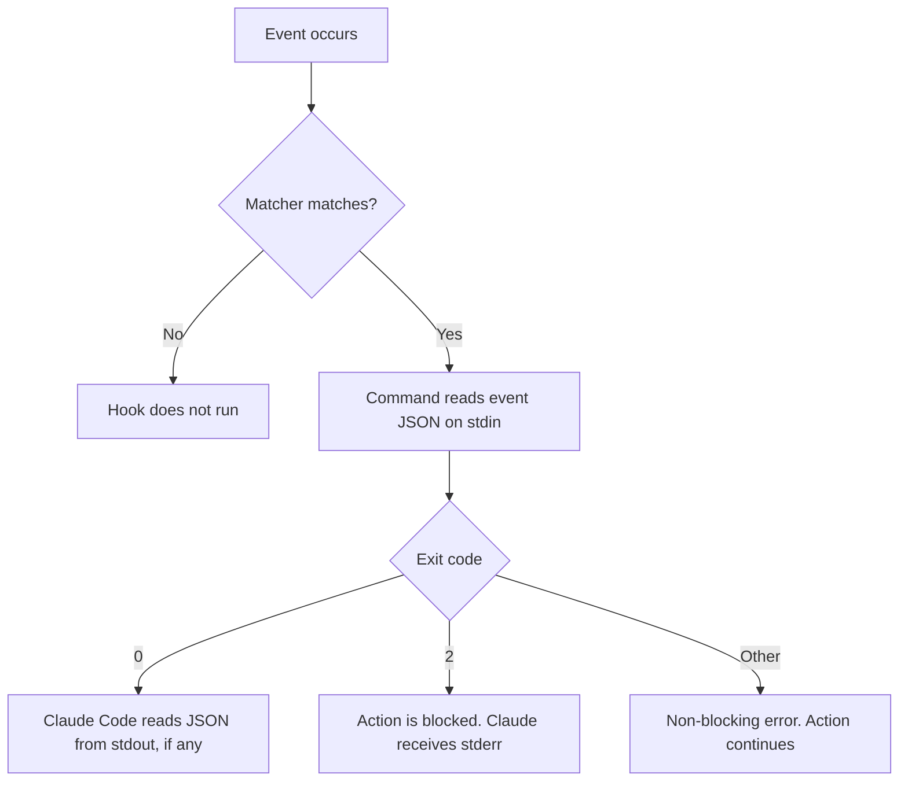

A hook is a command that Claude Code runs automatically at a specific point in a session. Examples are before a tool call, after a file edit, and when Claude finishes a response. Hooks let you format code, run a linter, or block a dangerous command every time, without asking Claude to remember.

Hooks are configured in the same `settings.json` files that the CLI and the **Code** tab in Claude Desktop both read. A hook that you commit to a repository runs for every teammate in both interfaces.

## Hooks compared to CLAUDE.md instructions

A CLAUDE.md instruction is advisory. Claude reads it as context and usually follows it. In a long session, Claude can forget the instruction or decide that it does not apply. A hook is deterministic. Claude Code runs it every time the event occurs, whatever Claude decides.

Use a [guideline file](/docs/general-tips/guideline-files) for conventions that need judgment, such as naming or architecture. Use a hook for a rule that must hold every time, such as "format each edited file" or "never force push". If a CLAUDE.md file says "always run the formatter", that instruction is a good candidate for a hook.

For a simple allow or deny rule on a command pattern, use `permissions.deny` first. See [Start with a minimum project settings file](/docs/general-tips/settings-file#start-with-a-minimum-project-settings-file). Use a hook when the rule needs logic that a pattern cannot express.

## Hook events

Each hook is attached to an event. The following events cover most development tasks:

| Event | When it runs | Typical use |
| --- | --- | --- |
| `PreToolUse` | Before a tool call runs. It can block the call. | Block dangerous shell commands or edits to protected files. |
| `PostToolUse` | After a tool call succeeds. | Format or lint the file that Claude edited. |
| `UserPromptSubmit` | When you submit a prompt, before Claude processes it. | Add context, such as the current branch, to each prompt. |
| `Notification` | When Claude Code sends a notification, for example to ask for permission. | Show a desktop notification. |
| `Stop` | When Claude finishes a response. | Run the tests. If they fail, Claude continues to work on the task. |
| `SessionStart` | When a session starts or resumes. | Load project state or environment variables. |
| `PreCompact` | Before Claude Code compacts the context. | Save notes that must survive compaction. |

Claude Code has many more events, for subagents, worktrees, configuration changes, and MCP servers. See the [full list of hook events](https://code.claude.com/docs/en/hooks#hook-lifecycle) in the hooks reference.

## How a hook works

A hook configuration has three levels. The **event** is the point in the lifecycle. The **matcher** filters when the hook runs, for example only for the `Edit` and `Write` tools. The **handler** is the command that runs.



- **Matcher.** For tool events, the matcher is the tool name. Use `|` to match more than one tool, for example `Edit|Write`. Matchers are case-sensitive. If you omit the matcher, the hook runs for every occurrence of the event.
- **Input.** Claude Code sends the event data as JSON on stdin. For a tool event, the JSON includes `tool_name` and `tool_input`. For the `Bash` tool, `tool_input.command` holds the shell command. For `Edit` and `Write`, `tool_input.file_path` holds the file path.
- **Exit code 0.** The hook has no objection. Exit code 0 does not approve a tool call: the normal permission flow still applies.
- **Exit code 2.** The hook blocks the action, on events that can be blocked. Claude Code sends the text on stderr to Claude as feedback, so that Claude can try another approach.
- **Other exit codes.** On most events, the action continues, and the transcript shows a hook error notice.
- **JSON output.** For more control, exit 0 and print a JSON object on stdout. For example, a `PreToolUse` hook can return `permissionDecision` with the value `deny`, `ask`, or `allow`, and a reason. Use exit code 2 or JSON in one hook, not both. See [decision control](https://code.claude.com/docs/en/hooks#decision-control) for the fields of each event.

Claude Code sets the `CLAUDE_PROJECT_DIR` environment variable to the project root. Use the `${CLAUDE_PROJECT_DIR}` placeholder in a hook command to reference a script in the repository, so that the hook works from any working directory.

When more than one hook matches an event, Claude Code runs them in parallel. Do not split steps that depend on each other, such as "format" and then "lint", into separate hooks on the same event.

## Hooks on Windows

A hook command has two forms, and the shell that runs it depends on the form:

- **Shell form** (no `args` field). Claude Code passes the `command` string to a shell. On macOS and Linux, the shell is `sh`. On Windows, the shell is Git Bash, or PowerShell if Git for Windows is not installed. The `shell` field selects a shell explicitly.
- **Exec form** (with an `args` field). Claude Code starts the executable in `command` directly, with no shell. Each element of `args` is one argument.

For a hook that must work on Windows and macOS, use exec form with `node` (or `python`) and a script file in the repository. This is the cross-platform pattern that the [hooks reference](https://code.claude.com/docs/en/hooks#exec-form-and-shell-form) recommends. The script parses the JSON input itself, so the hook does not need `jq`. Many examples in the official documentation use `jq`, which Windows does not include.

On Windows, the shell tools that Claude has depend on Git for Windows. Without Git for Windows, Claude has only the PowerShell tool. With Git for Windows, Claude has both tools: it uses PowerShell as the primary shell, and Bash for POSIX scripts. See [PowerShell tool](https://code.claude.com/docs/en/tools-reference#powershell-tool). A hook that inspects shell commands must match `Bash|PowerShell`, or it does not run for PowerShell commands.

The same applies to permission rules. A `Bash(...)` rule does not apply to the PowerShell tool. With Git for Windows installed, a `Bash(...)` deny rule also disables the PowerShell tool without a warning, if no settings file has a `PowerShell(...)` rule. If any settings file has a `PowerShell(...)` rule, the PowerShell tool stays available, and an unpaired `Bash(...)` deny rule does not restrict it. See [Bash deny rules also turn off the PowerShell tool](https://code.claude.com/docs/en/tools-reference#bash-deny-rules-also-turn-off-the-powershell-tool).

Two more details apply to Windows:

- In exec form, `command` must be a real executable, such as `node.exe`. The `.cmd` shims that npm installs, such as `npx.cmd` or `eslint.cmd`, do not start without a shell. Start the tool with `node` and the path of its JavaScript entry point instead.
- Claude Desktop does not read PowerShell profiles. Make sure that `node` is on the `PATH` in your Windows user or system environment variables, then restart Claude Desktop.

## Configure a project hook

A project hook is in `.claude/settings.json` in the repository. You commit it, so that every teammate gets the same hook. Hooks can also be in other settings files:

| Scope | File | Shared with |
| --- | --- | --- |
| User | `~/.claude/settings.json` | Only you, in every project |
| Project | `.claude/settings.json` | Your team, through version control |
| Local | `.claude/settings.local.json` | Only you, in this project |
| Managed policy | Set by your Claude Enterprise administrator | Everyone that the policy applies to |

Hooks from all scopes are combined. A project hook does not replace a user hook. For the other settings in these files, see [Settings files](/docs/general-tips/settings-file). Plugins, skills, and subagents can also define hooks. See [Plugins](/docs/cli/plugins) and the [hook locations](https://code.claude.com/docs/en/hooks-guide#configure-hook-location) in the hooks guide.

{}

### Write the hook script

Create the directory `.claude/hooks/` in the repository, and save the script there. This example uses the script in [Block unsafe commands](#block-unsafe-commands).

Test the script before you register it. Send sample JSON to it on stdin, and check the output and the exit code:



Run the following commands in PowerShell:

```powershell
'{"tool_name":"Bash","tool_input":{"command":"git push --force"}}' | node .claude/hooks/block-dangerous-commands.js
$LASTEXITCODE
```


Run the following commands in a terminal:

```shell
echo '{"tool_name":"Bash","tool_input":{"command":"git push --force"}}' | node .claude/hooks/block-dangerous-commands.js
echo $?
```



The script prints a JSON `deny` decision and exits with code 0.

### Register the hook in the settings file

Open `.claude/settings.json` in the repository root, or create it. Add a `hooks` object:

```json {filename=".claude/settings.json"}
{
  "hooks": {
    "PreToolUse": [
      {
        "matcher": "Bash|PowerShell",
        "hooks": [
          {
            "type": "command",
            "command": "node",
            "args": ["${CLAUDE_PROJECT_DIR}/.claude/hooks/block-dangerous-commands.js"],
            "timeout": 10,
            "onFailure": "block"
          }
        ]
      }
    ]
  }
}
```

If the file already has a `hooks` object, add the event as a new key inside it. Do not add a second `hooks` object. The file must be valid JSON, with no comments and no trailing commas.

`"onFailure": "block"` blocks the tool call if the script fails to start, crashes, or times out. Without it, Claude Code runs the command when a safety hook fails. See [Block the action when a hook fails](https://code.claude.com/docs/en/hooks#block-the-action-when-a-hook-fails).

`onFailure` requires Claude Code v2.1.295 or later. On an older version, a safety hook that fails does not block the command. To check your version, run the following command:

```shell
claude --version
```

### Review and test the hook



1. Edit `.claude/settings.json` in your code editor. The file pane in Claude Desktop shows `.claude/settings.json` as view-only. To edit it from Claude Desktop, right-click the file and open it in another app.
2. Create an empty directory named `hook-test` in the repository root.
3. In the **Code** tab, start a new local session in the repository. Hooks from settings files run in local sessions of the **Code** tab.
4. Ask Claude to delete the `hook-test` directory with the following command:

   ```text
   rm -r ./hook-test
   ```

   If Claude Code asks for permission, select **No**.

Claude reports that a project hook blocked the command, with the reason from the script. The `hook-test` directory still exists. To list the hooks that Claude Code loaded, run `/hooks` in the Claude Code CLI.
<!-- SCREENSHOT: Claude Desktop Code tab, showing a tool call that a PreToolUse hook blocked, with the reason text. Use a sample repository with no internal names. -->


1. Start a session in the repository, or continue the current session. Claude Code reloads changed settings files automatically. If the hook does not appear, restart the session.
2. Run the following command in the session:

   ```text
   /hooks
   ```

   The hooks browser lists the hook under `PreToolUse`, labeled with its source, project settings. Select the hook to see the full command.
3. Press `Esc` to close the browser.
4. Create an empty directory named `hook-test` in the repository root.
5. Ask Claude to delete the `hook-test` directory with the following command:

   ```text
   rm -r ./hook-test
   ```

   If Claude Code asks for permission, select **No**.

Claude reports that a project hook blocked the command, with the reason from the script. The `hook-test` directory still exists.



Do not test a safety hook with a command that destroys work, such as `git reset --hard`. If the hook is not active, Claude Code runs the command. To test with a real command, use a scratch clone of the repository. Remove the `hook-test` directory after the test.

### Commit the hook

Commit `.claude/settings.json` and the script in `.claude/hooks/` together. A hook that references a script that is not in the repository fails for every teammate.

{}

You can also ask Claude to write a hook for you. Describe the check, the event, and the platforms. See [Write a hook for a repeated check](/docs/prompts/maintenance#write-a-hook-for-a-repeated-check).

## Common hooks

The examples in this section use Node.js scripts in exec form, so that they work on Windows and macOS. If your team does not use Node.js, write the same logic in Python and start it with `python` in the `command` field.

For a `UserPromptSubmit` hook that adds a reminder to each prompt, see [Make the reminder reliable with a hook](/docs/general-tips/counter-files#make-the-reminder-reliable-with-a-hook) on the Counter files page.

### Block unsafe commands

A `PreToolUse` hook on `Bash|PowerShell` can deny a command before it runs. A hook deny applies in every permission mode, including `bypassPermissions`. See [Hooks and permission modes](https://code.claude.com/docs/en/hooks-guide#hooks-and-permission-modes).

The script splits the command into segments at `;`, `|`, `&`, and line breaks, and each segment into words. It then tests each segment against a list of rules. The test in [Review and test the hook](#review-and-test-the-hook) uses the rule for recursive deletes. The following excerpt shows that rule and the decision that the script returns:

```javascript {filename=".claude/hooks/block-dangerous-commands.js"}
// rm (Bash, and the PowerShell alias), Remove-Item and its aliases, and cmd.exe commands.
const DELETE_COMMANDS = new Set(['rm', 'remove-item', 'ri', 'del', 'erase', 'rd', 'rmdir']);

// -r, -rf, -f -r, --recursive, -Recurse and its abbreviations, and /s.
const RECURSIVE_FLAG = [
  /^-[dfiIvrR]*[rR][dfiIvrR]*$/,
  /^--recursive$/,
  /^-r(e(c(u(r(s(e)?)?)?)?)?)?(:\S*)?$/i,
  /^\/s$/i,
];

const RULES = [
  {
    reason: 'Recursive delete is blocked by a project hook. Delete specific files, or ask the user to run the command.',
    test: (words) =>
      words.some(
        (word, i) =>
          DELETE_COMMANDS.has(word.toLowerCase()) &&
          words[i - 1] !== 'git' && // git rm -r --cached only changes the index
          words.slice(i + 1).some((arg) => RECURSIVE_FLAG.some((flag) => flag.test(arg))),
      ),
  },
  // Two more rules block force push (--force, -f, -uf, +main) and git reset --hard.
];

// ...after the script parses the JSON input from stdin:
const command = (input.tool_input && input.tool_input.command) || '';
const rule = RULES.find((r) => segments(command).some((words) => r.test(words)));
if (rule) {
  process.stdout.write(JSON.stringify({
    hookSpecificOutput: {
      hookEventName: 'PreToolUse',
      permissionDecision: 'deny',
      permissionDecisionReason: rule.reason,
    },
  }));
}
```

[Download the complete block-dangerous-commands.js](/examples/cli/hooks-block-dangerous-commands.js) and save it as `.claude/hooks/block-dangerous-commands.js`.

Write the reason for Claude. A reason that says what to do instead helps Claude continue the task without a blocked command. A list of rules cannot find every way to write a command. Keep `permissions.deny` or `permissions.ask` rules for the same commands, and add a `PowerShell(...)` rule for each `Bash(...)` rule.

### Format and lint after each edit

A `PostToolUse` hook on `Edit|Write` can format the file that Claude changed and then lint it. If the formatter cannot parse the file, or the linter finds problems, the hook returns a `block` decision. The tool call has already run, so nothing is undone. Claude receives the linter output next to the tool result and fixes the problems in the next step.

The following excerpt shows how the script starts each tool and reports problems to Claude:

```javascript {filename=".claude/hooks/format-and-lint.js"}
function run(projectDir, bin, args) {
  return spawnSync(process.execPath, [bin, ...args], { cwd: projectDir, encoding: 'utf8' });
}

function block(reason) {
  process.stdout.write(JSON.stringify({ decision: 'block', reason }));
}

// 1. Format the edited file. Prettier fails when the file has a syntax error.
const formatted = run(projectDir, prettier, ['--write', '--ignore-unknown', filePath]);
if (formatted.status !== 0) {
  block(`Prettier could not format ${filePath}. Fix the file:\n${formatted.stderr || formatted.stdout}`);
  return;
}

// 2. Lint it. ESLint exits 1 when it finds problems.
const linted = run(projectDir, eslint, [filePath]);
if (linted.status === 1) {
  block(`ESLint found problems in ${filePath}. Fix them:\n${linted.stdout}`);
}
```

[Download the complete format-and-lint.js](/examples/cli/hooks-format-and-lint.js) and save it as `.claude/hooks/format-and-lint.js`.

The script finds Prettier and ESLint in the repository's `node_modules` directory and starts them with the same `node` executable. It does not use `npx` or a shell, so it avoids the `.cmd` shim problem on Windows. If a tool is not installed, the script skips that step. To use another formatter or linter, replace the package names and the arguments.

Keep a format hook fast. It runs after every edit, and a slow hook delays each step of the session.

### Bash and jq variant for macOS

If your team works only on macOS or Linux and has `jq` installed, a shell-form hook is shorter. This variant runs Prettier on the edited file:

```json {filename=".claude/settings.json"}
{
  "hooks": {
    "PostToolUse": [
      {
        "matcher": "Edit|Write",
        "hooks": [
          {
            "type": "command",
            "command": "jq -r '.tool_input.file_path' | xargs npx prettier --write"
          }
        ]
      }
    ]
  }
}
```

Do not commit this variant to a repository that Windows developers use. On Windows, it depends on Git Bash and on `jq`.

## Debug a hook

When a hook does not behave as you expect, check what it received and what it returned.



1. Select the **Verbose** view mode, so that the transcript shows every tool call and its result.
2. For the full stdout, stderr, and exit code, reproduce the problem in the Claude Code CLI with debug logging enabled. The CLI reads the same settings files. See [Use Claude Code Desktop](https://code.claude.com/docs/en/desktop).


1. Press `Ctrl+O` to open the transcript view. A successful hook shows nothing. A blocked action shows the reason. A failed hook shows a `<hook name> hook error` notice with the first line of stderr.
2. For the full details, start Claude Code with debug logging:

   ```shell
   claude --debug
   ```

   Claude Code writes the log to `~/.claude/debug/<SESSION_ID>.txt`. It does not print the log to the terminal. To enable logging in a session that is already running, run `/debug`.
3. Search the log for `Hooks:`. Each line gives the event, the command, the exit status, and the duration of a hook run.



`<SESSION_ID>` is the ID of the session. See [Debug hooks](https://code.claude.com/docs/en/hooks#debug-hooks) for the log format.

The following failures are common:

| Symptom | Cause and fix |
| --- | --- |
| The hook never runs. | The matcher does not match the tool name. Matchers are case-sensitive. On Windows, a hook that matches only `Bash` does not run for PowerShell commands. |
| The hook does not appear in `/hooks`. | The settings file is not valid JSON, or it is in the wrong location. If the menu says that only managed hooks run, your administrator has restricted hooks. |
| `command not found` or `Cannot find module`. | The script path is relative or wrong. Use `${CLAUDE_PROJECT_DIR}` in the path. On Windows, check that `node` is on the `PATH`. |
| The script does not run on macOS (permission denied). | A shell-form hook that runs a script directly needs the execute bit. Run `chmod +x` on the script, or use exec form with `node`. |
| `jq: command not found`. | The hook uses `jq`, which is not installed. Parse the JSON in the script instead. |
| The JSON decision has no effect. | Something printed text before the JSON, often a shell profile, or a field is at the wrong level. `permissionDecision` belongs inside `hookSpecificOutput`. Build the output with a JSON encoder, not by string concatenation. |
| `blocking because Git Bash wasn't found`. | On Windows without Git Bash, a shell-form hook ran in PowerShell and failed. Use exec form, set the `shell` field, or install Git for Windows. |
| Each step is slow, or the hook is cancelled. | The hook is slow, or it reached its `timeout` (in seconds). A timed-out hook makes no decision. Make the hook faster, raise the `timeout`, or set `"onFailure": "block"` for a safety hook. |

To test a hook outside Claude Code, send sample JSON to the script on stdin, as in [Write the hook script](#write-the-hook-script). For more cases, see [Limitations and troubleshooting](https://code.claude.com/docs/en/hooks-guide#limitations-and-troubleshooting).

## Security

A command hook runs with the permissions of your user account. It can read, change, or delete every file that you can access, and it can send data over the network. A hook in a repository's `.claude/settings.json` is code that runs on your computer, the same as a build script.

- Review `.claude/settings.json`, `.claude/settings.local.json`, and the scripts in `.claude/hooks/` before you trust a repository that you did not write. See [Review the hooks in a repository](/docs/prompts/review#review-the-hooks-in-a-repository-before-you-trust-it).
- In an interactive session, Claude Code does not run hooks from settings files until you accept the workspace trust dialog for the folder. The dialog lists the permission rules and directories that the folder would grant, so review the hook files yourself. See [Project allow rules and workspace trust](https://code.claude.com/docs/en/permissions#project-allow-rules-and-workspace-trust).
- If you already trusted a parent folder, the hooks run without a new dialog. In non-interactive mode (`claude -p`), there is no dialog, and the hooks run. See [workspace trust](https://code.claude.com/docs/en/hooks#workspace-trust).
- Review changes to hook files in pull requests with the same care as changes to CI configuration.
- In hook scripts, validate the input, quote variables, and use absolute paths.


A Claude Enterprise administrator can control hooks through managed settings. `allowManagedHooksOnly` runs only the hooks that the organization deploys, and blocks hooks from user, project, and local settings. `disableAllHooks` in managed settings disables all hooks. If your hooks do not run and `/hooks` reports that only managed hooks run, ask your administrator. See [`allowManagedHooksOnly`](https://code.claude.com/docs/en/settings-reference#allowmanagedhooksonly).


## Example hook configuration

This configuration combines the two common hooks. It blocks unsafe shell commands and formats and lints each edited file:

```json {filename=".claude/settings.json"}
{
  "$schema": "https://json.schemastore.org/claude-code-settings.json",
  "hooks": {
    "PreToolUse": [
      {
        "matcher": "Bash|PowerShell",
        "hooks": [
          {
            "type": "command",
            "command": "node",
            "args": ["${CLAUDE_PROJECT_DIR}/.claude/hooks/block-dangerous-commands.js"],
            "timeout": 10,
            "onFailure": "block"
          }
        ]
      }
    ],
    "PostToolUse": [
      {
        "matcher": "Edit|Write",
        "hooks": [
          {
            "type": "command",
            "command": "node",
            "args": ["${CLAUDE_PROJECT_DIR}/.claude/hooks/format-and-lint.js"],
            "timeout": 60
          }
        ]
      }
    ]
  }
}
```

Download the files and save them in the repository:

| Download | Save as |
| --- | --- |
| [hooks-settings.json](/examples/cli/hooks-settings.json) | `.claude/settings.json` |
| [hooks-block-dangerous-commands.js](/examples/cli/hooks-block-dangerous-commands.js) | `.claude/hooks/block-dangerous-commands.js` |
| [hooks-format-and-lint.js](/examples/cli/hooks-format-and-lint.js) | `.claude/hooks/format-and-lint.js` |

The `$schema` line enables completion and validation for the settings file in VS Code. If the repository already has a `.claude/settings.json` file, merge the `hooks` object into it. Do not replace the file. The scripts need Node.js on each developer's computer. The format-and-lint script also needs Prettier and ESLint as development dependencies of the repository.

## Related prompts

- [Write a hook for a repeated check](/docs/prompts/maintenance#write-a-hook-for-a-repeated-check)
- [Review the hooks in a repository before you trust it](/docs/prompts/review#review-the-hooks-in-a-repository-before-you-trust-it)

## Further reading

- [Automate actions with hooks](https://code.claude.com/docs/en/hooks-guide) (hooks guide)
- [Hooks reference](https://code.claude.com/docs/en/hooks)
- [Use Claude Code Desktop](https://code.claude.com/docs/en/desktop)
- [Settings reference](https://code.claude.com/docs/en/settings-reference)
- [Guideline files](/docs/general-tips/guideline-files)
- [Plugins](/docs/cli/plugins)
