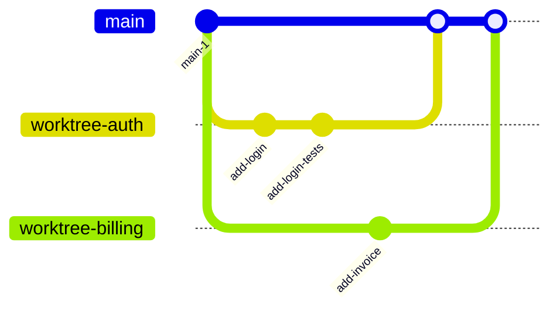

Claude can change many files in a few minutes. When two unrelated tasks share one working tree, their changes mix together, and a review or a revert then affects both tasks at once. Give each task its own branch, and run it in its own Git worktree, so that the tasks stay independent until you merge them back.

## Concepts

A Git worktree is a separate working directory with its own files and its own checked-out branch. All worktrees of a repository share the same history and the same remote. A commit in one worktree is part of the same repository as a commit in another, so you do not need a second clone.

Claude Desktop and the Claude Code CLI both create worktrees under `.claude/worktrees/` at the root of the repository, by default. Add this directory to the `.gitignore` file of the repository, so that worktrees do not appear as untracked files in your main checkout.

The following diagram shows two tasks, each in its own worktree branch, that start from `main` and later merge back into it:



## Give each task its own branch

Start a new branch for each task that you give Claude, even a small one. A branch that holds one task is easy to review, easy to test on its own, and easy to revert if the task does not work out. A branch that holds two unrelated tasks forces you to review and accept, or revert, both of them together.

Name the branch for the task, not for Claude. A teammate who reviews the branch later, or an automated check that runs against it, does not need to know that Claude wrote the change.

## Run parallel sessions in a worktree

Start a session in its own worktree when you want to run more than one task at the same time, or when you want to keep a task's changes out of your main checkout until you review them. Claude Desktop and the Claude Code CLI create the worktree in the same default location, but you start one in a different way in each interface.



Turn on **Worktree** before you start a session, in the row under the prompt box. If you do not see **Worktree** there, select the project folder control first. To make **Worktree** the default for a saved environment, set it when you create or edit the environment.

<!-- SCREENSHOT: Claude Desktop, the row under the prompt box before a session starts, with the Worktree toggle visible next to the project folder control. Use a sample project with no internal names. -->

By default, Claude Desktop stores worktrees in `.claude/worktrees/` at the root of the project. To use a different location, set **Worktree location** in **Settings** > **Code**. Set **Branch prefix** in the same settings page to add a prefix to every worktree branch that Claude Desktop creates, so that you can find them later.

In a worktree session that you start from Claude Desktop, project settings, hooks, skills, subagents, commands, and MCP servers load from your main checkout, not from the worktree. The CLAUDE.md file and `.claude/rules/` still load from the worktree itself. Keep this in mind if you edit a guideline file inside a worktree session and expect the change to apply to your main checkout.


Pass `--worktree` or `-w` with a name when you start Claude Code:

```shell
claude --worktree auth-fix
```

Claude Code creates the worktree at `.claude/worktrees/auth-fix/`, on a new branch named `worktree-auth-fix`, and starts the session there. If you omit the name, Claude Code generates one. The first time you use `--worktree` in a repository, run `claude` there once without it, so that you trust the folder.

To return to a worktree session later, run the following command:

```shell
claude --worktree auth-fix --resume
```

You can also create a worktree directly from a pull request or merge request, to review it without changing your main checkout. Pass the number with a leading `#`, quoted so that your shell does not treat it as a comment, or pass the full URL:

```shell
claude --worktree "#1234"
```

For the complete syntax, including merge requests and self-managed Git hosts, see [Branch from a pull request](https://code.claude.com/docs/en/worktrees#branch-from-a-pull-request).



### Isolate subagents automatically

A subagent that changes many files can collide with your own edits in the same working tree. Ask Claude to "use worktrees for your agents" so that each subagent it starts gets its own worktree for the rest of the session. To set this permanently for one subagent, add `isolation: worktree` to its frontmatter:

```markdown {filename=".claude/agents/refactorer.md"}
---
name: refactorer
description: Applies mechanical refactors across many files
isolation: worktree
---

Apply the requested refactor across every affected file, then run the tests
and report the results.
```

Claude Code removes a subagent's worktree automatically once the subagent finishes and leaves no changes behind. For the complete behavior, see [Isolate subagents with worktrees](https://code.claude.com/docs/en/worktrees#isolate-subagents-with-worktrees).

### Branch a worktree from your current work instead of from main

By default, a new worktree branches from the default branch on the remote, so that it starts from a clean tree. Set `worktree.baseRef` to `"head"` in your settings to branch from your current local `HEAD` instead, so that the worktree carries your unpushed commits. This setting is useful when you isolate a subagent that must continue work that you have not pushed yet:

```json {filename=".claude/settings.json"}
{
  "worktree": {
    "baseRef": "head"
  }
}
```

For the complete behavior of each value, see the [`worktree.baseRef` setting](https://code.claude.com/docs/en/settings-reference#worktree-baseref).

## Merge and clean up a workstream

Before you merge a workstream, review its complete diff and run its tests, in the same way as any other branch. Ask Claude to summarize the branch first if you want a first draft of the pull request description. See [Summarize a branch before you open a pull request](/docs/prompts/review#summarize-a-branch-before-you-open-a-pull-request).

### Resolve conflicts between workstreams

Two workstreams that change the same file produce a merge conflict when you bring one of them up to date with the other, or merge both into `main`. Ask Claude to resolve the conflict in the branch that is behind, and review its resolution before you continue, in the same way as you review any other change that Claude makes. See [Resolve a merge conflict between two workstreams](/docs/prompts/version-control#resolve-a-merge-conflict-between-two-workstreams).

### Clean up the worktree

Cleanup differs between the two interfaces.



Claude Desktop ties worktree cleanup to archiving a session, not to merging its branch. To archive a session, hover over it in the sidebar, open its menu, and select **Archive**.


Archiving a session can discard uncommitted changes in its worktree. If Claude Desktop asks about uncommitted changes when you archive, commit the ones that you want to keep, or select **Archive anyway** to discard them. If a pull request that Claude opened in the session has merged, Claude Desktop can delete the remaining untracked files without asking, so commit the ones that you want to keep before the merge.


<!-- SCREENSHOT: Claude Desktop, the dialog that appears when you archive a session whose worktree has uncommitted changes, with the Archive anyway option visible. Use a sample project with no internal names. -->

If Claude Desktop does not ask about uncommitted changes, the worktree stays on disk. For a local session, Claude Desktop removes it about 30 days after you archive the session or last open it, whichever is later. To keep the changes, open the session from the **Archived** tab and select **Unarchive**.


When you end an interactive `--worktree` session, Claude Code checks it for uncommitted changes, untracked files, and commits that you have not merged. A clean worktree from an unnamed session is removed at once. A named session, or one with changes, prompts you to keep or remove it. Keeping it prints the resume command from [Run parallel sessions in a worktree](#run-parallel-sessions-in-a-worktree).

A non-interactive `claude -p --worktree` run does not prompt you and does not remove the worktree, because no person is present to answer. Remove it yourself once you no longer need it:

```shell
git worktree remove <PATH>
```

Add `--force` if the worktree has uncommitted or untracked changes that you want to discard. For the complete cleanup behavior, including subagent worktrees, see [Clean up worktrees](https://code.claude.com/docs/en/worktrees#clean-up-worktrees).



## Further reading

- [Run parallel sessions with worktrees](https://code.claude.com/docs/en/worktrees)
- [Run a session in its own worktree](https://code.claude.com/docs/en/desktop#run-a-session-in-its-own-worktree)
- [Settings reference](https://code.claude.com/docs/en/settings-reference)
- [Settings files](/docs/general-tips/settings-file)
- [Commit hooks](/docs/version-control/commit-hooks)
- [Sandboxes](/docs/general-tips/sandboxes)
