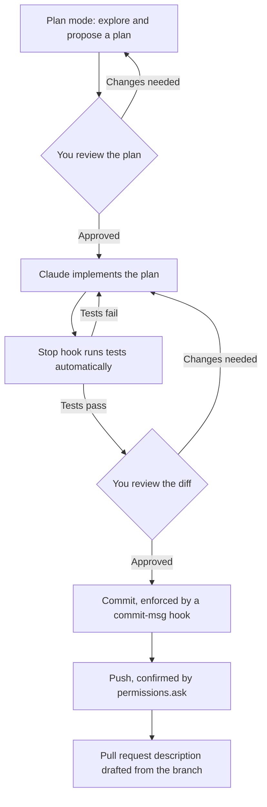

The other pages in this section explain one stage of development at a time. This page assumes that setup already exists. A CLAUDE.md file and any rules under `.claude/rules/` describe your project; see [Guideline files](/docs/general-tips/guideline-files). Skills cover your repeated workflows; see [Skills and plugins](/docs/general-tips/skills-and-plugins). A settings file sets safe permission rules, and your team has already written the hooks it needs. With that in place, the day-to-day path for one feature is short enough to describe completely.



{}

### Start in Plan mode

Open the task in Plan mode and let Claude read the relevant files before it proposes anything. Review the plan the same way you would read a short specification, not a diff. See [Planning and specification](/docs/workflows/planning).

```text
Start in Plan mode. Before you write the plan, read the files in
<RELEVANT_PATHS> and ask me about anything in the requirement below
that is ambiguous. Do not propose a plan until I answer.

Requirement: <REQUIREMENT>
```

See [Write a specification before you implement a feature](/docs/prompts/planning#write-a-specification-before-you-implement-a-feature) for the complete prompt.

### Implement from the approved plan

Once you approve the plan, Claude exits Plan mode and starts to edit files. If a similar feature already exists in the codebase, name it as a reference in the same message that approves the plan. This avoids having Claude work out your conventions again from the code alone. See [Use reference implementations](/docs/patterns/reference-implementations).

A skill that matches the task loads automatically during this step, without you doing anything extra. If nothing loads and you expected it to, see [Refactor a skill's description](/docs/patterns/build-test-refactor-a-skill#refactor-a-skills-description).

### Let the repeatable checks run themselves

The checks that do not need judgment should run without you asking for them each time. This keeps your own review focused on the checks that do need judgment. Two pieces of setup carry most of this load:

- A `Stop` hook that runs your test command after each turn and sends Claude back to work if it fails. See [Run the tests automatically when Claude finishes a turn](/docs/workflows/testing#run-the-tests-automatically-when-claude-finishes-a-turn) for the complete script.
- A `commit-msg` hook that rejects a commit whose subject does not follow your convention. See [Example: enforce a commit message convention](/docs/version-control/commit-hooks#example-enforce-a-commit-message-convention) for the complete script.

Both register in the same settings file, alongside the permission rule that lets Claude run your test command without a prompt each time:

```json {filename=".claude/settings.json"}
{
  "$schema": "https://json.schemastore.org/claude-code-settings.json",
  "permissions": {
    "allow": [
      "Bash(npm test *)",
      "PowerShell(npm test *)"
    ],
    "ask": [
      "Bash(git push *)",
      "PowerShell(git push *)"
    ]
  },
  "hooks": {
    "Stop": [
      {
        "hooks": [
          {
            "type": "command",
            "command": "node",
            "args": ["${CLAUDE_PROJECT_DIR}/.claude/hooks/run-tests-on-stop.js"],
            "timeout": 120
          }
        ]
      }
    ]
  }
}
```

Replace `npm test` with your own test command. The `commit-msg` hook is a Git hook, not a Claude Code hook. It is not part of this file. See [Share a Git hook with your team](/docs/version-control/commit-hooks#share-a-git-hook-with-your-team) for where it lives and how your team installs it.

### Review before anything leaves your working copy

Read the diff once the tests pass and before you commit, in the same way as you would review a teammate's change. See [Review the diff before you commit or merge](/docs/version-control/commits-and-pull-requests#review-the-diff-before-you-commit-or-merge) and, for the general framework behind where a checkpoint like this belongs, [Force human review](/docs/patterns/human-review).

### Commit, push, and open the pull request

Commit with the convention from your CLAUDE.md file. The `commit-msg` hook catches a message that does not follow it before Git creates the commit. See [Write commit messages that fit your project](/docs/version-control/commits-and-pull-requests#write-commit-messages-that-fit-your-project).

Pushing asks for confirmation because of the `permissions.ask` rule above. This holds even if the session is otherwise running in a faster mode. See [Confirm before Claude pushes or rewrites history](/docs/version-control/commits-and-pull-requests#confirm-before-claude-pushes-or-rewrites-history).

Ask Claude to draft the pull request description from the branch, not only the last commit, so that it reflects everything the feature touched. See [Draft a pull request description from the branch](/docs/version-control/commits-and-pull-requests#draft-a-pull-request-description-from-the-branch).

{}

## When the feature does not fit the ideal path

The steps above assume the plan held, the tests passed on their own, and the diff matched what you expected. When one of those breaks down, go back one step instead of continuing anyway. A test that fails for a reason the plan did not anticipate is a reason to revise the plan, not only the code. A diff that is much larger than the plan suggested is a reason to review it as closely as you would an unplanned change. See [Review and approve a plan](/docs/workflows/planning#review-and-approve-a-plan) for treating a large deviation from an approved plan as a reason to look again.

## Good practice

- Keep the Plan mode review and the diff review as two separate checkpoints. Approving the plan is not the same as approving the result.
- Register the repeatable checks, tests and commit message format, as hooks, so that neither depends on remembering to run them.
- Name a reference implementation when one exists, instead of letting Claude re-derive a convention your codebase already states.
- Treat a large deviation from the plan as a reason to review again, not as a sign that something went wrong.

## Further reading

- [Planning and specification](/docs/workflows/planning)
- [Use reference implementations](/docs/patterns/reference-implementations)
- [Testing](/docs/workflows/testing)
- [Commit hooks](/docs/version-control/commit-hooks)
- [Commits and pull requests](/docs/version-control/commits-and-pull-requests)
- [Force human review](/docs/patterns/human-review)
- [Automate a recurring workflow](/docs/patterns/automate-a-workflow), for packaging this whole sequence into one trigger
