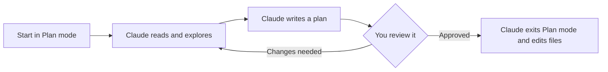

Claude can start editing files within seconds of your first message. For a small, well-understood change, that speed is the point. For anything larger, it is a risk: Claude can build on a wrong assumption for a long time before you notice, because nothing stops it from writing code while it is still wrong. Planning first gives you a cheap, text-only point to catch that mistake, before it is a diff across many files.

## Plan mode separates exploring from editing

Plan mode is a permission mode. While it is active, Claude can read files, search the repository, and run read-only commands, but it cannot edit a file or run a command that changes anything. Claude works toward a plan instead, and presents it for your approval before it changes a single file.



Switch to Plan mode with `Shift+Tab` in the CLI, the mode selector in Claude Desktop, or `--permission-mode plan` when you start a session. Plan mode applies only to the current session, so a switch does not change the default for your next one. For the complete steps in both interfaces, see [Switch the permission mode](/docs/cli/common-tasks#switch-the-permission-mode). To start every session in Plan mode in one repository, set `permissions.defaultMode` to `"plan"` in your local settings, described in [Common settings](/docs/general-tips/settings-file#common-settings).

## Give Claude the context before you ask for a plan

A plan is only as good as what Claude read before writing it. Point Claude at the requirements, the files that the change touches, and any constraint that is not obvious from the code, in the same message that asks for the plan. If your team has a spec format, for example required sections or a level of detail, put it in your CLAUDE.md file once, so that every plan follows it without you restating it each session. See [Guideline files](/docs/general-tips/guideline-files).

By default, Claude Code saves a plan to a file in your user directory, not in the repository, so a plan does not appear in your working tree or in Git by default. To save plans to a project directory instead, for example to keep one as a record next to the code it describes, set the [`plansDirectory` setting](https://code.claude.com/docs/en/settings-reference#plansdirectory).

## Review and approve a plan

Read the plan the same way you would read a pull request description: check that it covers the actual requirement, not a simplified version of it, and that it does not skip a part of the codebase that the change should touch. Approving the plan exits Plan mode for that session, and Claude starts to edit files according to it.

A plan that you approve is not a contract. Claude can still find, partway through, that the plan does not work as written. Treat a large deviation from the approved plan the same way you would treat a pull request that grew past its description: worth a second look before you accept the result.

For a team process that requires this review before anyone merges the result, not only before Claude starts editing, see [Force human review](/docs/patterns/human-review).

## Recommended skills and plugins for this stage

[spec-kit](https://github.com/github/spec-kit) is an open source, agent-agnostic toolkit for spec-driven development: writing a specification, a plan, and a task breakdown as separate, reviewable artifacts before implementation. For Claude Code specifically, it installs as a set of real Claude Code skills, not a plugin: running `specify init <PROJECT> --integration claude` writes files to `.claude/skills/speckit-<command>/SKILL.md` and adds hyphenated slash commands such as `/speckit-specify`, `/speckit-plan`, and `/speckit-tasks`. It also touches `.claude/settings.json` to register native events for some commands.

Before you run `specify init` in a repository, read the `SKILL.md` files that it writes, and check the diff that it makes to `.claude/settings.json`, in the same way as you would review any skill that you did not write yourself. `specify init` does not go through Claude Code's plugin marketplace, so [Review a plugin before you install it](/docs/cli/plugins#review-a-plugin-before-you-install-it) does not apply to it directly; read the installed skill files instead.

spec-kit produces the plan. [Beads](https://github.com/gastownhall/beads) tracks the work once the plan turns into a backlog that spans more than one session. It holds issues in a dependency graph, instead of a flat list. Its `bd ready` command finds the tasks that nobody is blocked on. Beads is a standalone command-line tool, backed by a version-controlled database, not a skill or a plugin by itself. Install it once per machine, for example with `brew install beads`.

Run `bd init` in a project to start tracking issues there. By default, this also installs the Claude Code integration described below, unless you pass `--skip-agents` or `--stealth`.

For Claude Code, the maintainers recommend a `SessionStart` hook (see [Hook events](/docs/cli/hooks#hook-events)) over an MCP server. The hook runs `bd prime`, which adds only a small, fixed amount of workflow context. An MCP server's tool definitions can add much more. See [What fills the context window](/docs/general-tips/context#what-fills-the-context-window). Hooks use the same `settings.json` mechanism in Claude Desktop's **Code** tab as in the CLI, so this works the same way in both interfaces. See [Hooks compared to CLAUDE.md instructions](/docs/cli/hooks#hooks-compared-to-claudemd-instructions). Run `bd setup claude` to add the hook directly, without a full `bd init`.

A separate official plugin adds `/beads:*` slash commands and a `@task-agent` subagent that claims and completes ready tasks without asking first. Install it by running the following commands:

```text
/plugin marketplace add gastownhall/beads
/plugin install beads
```

Review the hook or the plugin before you trust it, the same as any other hook or plugin. Read an autonomous, task-claiming subagent closely before you let it run unattended. See [Review a plugin before you install it](/docs/cli/plugins#review-a-plugin-before-you-install-it) and [Force human review](/docs/patterns/human-review).

## Related prompts

- [Write a specification before you implement a feature](/docs/prompts/planning#write-a-specification-before-you-implement-a-feature)

## Further reading

- [Permission modes](https://code.claude.com/docs/en/permission-modes)
- [`plansDirectory` setting](https://code.claude.com/docs/en/settings-reference#plansdirectory)
- [Common task reference](/docs/cli/common-tasks)
- [Counter files](/docs/general-tips/counter-files), for a plan that belongs to one task in an ongoing backlog rather than one session
- [Guideline files](/docs/general-tips/guideline-files)
- [Force human review](/docs/patterns/human-review)
- [spec-kit documentation](https://github.github.io/spec-kit/)
- [Beads documentation](https://beads.gascity.com/)
